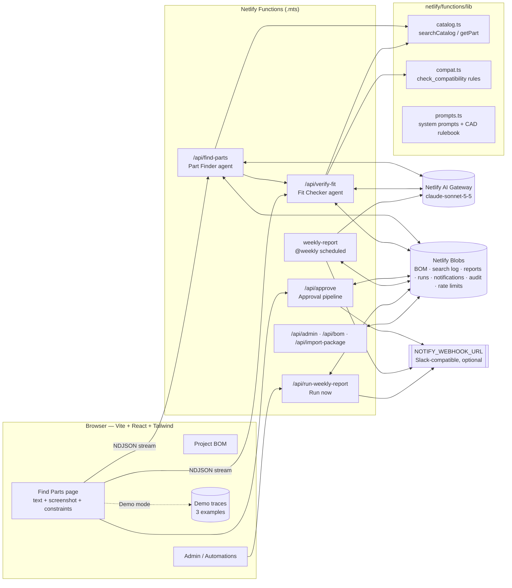

# PartPilot — find and verify CAD parts in seconds

**User:** mechanical design engineers at a CAD-focused company.
**Problem:** engineers spend a long time searching a large online parts library (fasteners, bearings, brackets, gears, shafts…) for the right part to import into an assembly.
**PartPilot:** the engineer describes what they are building, optionally with a CAD screenshot. Two AI agents then find, verify, and hand back the exact parts to import. A one-click approval adds them to the project BOM and produces an import package.

> The system recommends and verifies; the engineer decides.

## Architecture



## The two agents

Both agents run a real Anthropic Messages API tool-use loop (`netlify/functions/lib/agent.ts`). The model picks a tool, the function runs it, the result goes back to the model, and the loop repeats until the model gives a final answer. Each agent is limited to **5 iterations** and **1,500 max_tokens per call**, and has a soft 16 s wall-clock budget after which it must answer. The full step trace (tool, arguments, result summary, reasoning note) streams to the UI live.

| Agent | Endpoint | Tools | Output |
|---|---|---|---|
| **Part Finder** | `POST /api/find-parts` | `search_catalog`, `get_part`, `list_categories`, `ask_user` | `{ understanding, visionObservations, confidence, needs[{need, requirement, candidates[{partId, reason, matchScore}]}], clarifyingQuestion? }` |
| **Fit Checker** | `POST /api/verify-fit` | `get_part`, `check_compatibility`, `search_catalog` | `{ verdicts[{need, partId, originalPartId?, verdict, checks, notes}], overallConfidence, humanReviewRequired, reasonsForReview }` |

All LLM JSON is validated with zod. If validation fails, the agent gets one retry with the error message; after that the user sees a friendly error. Deterministic guardrails run after the Fit Checker: they re-check rules, downgrade a failing APPROVE to ESCALATE, and force human review when confidence is below 0.70 or the use is safety-critical. See [docs/AGENTS.md](docs/AGENTS.md).

## The two automations

1. **Approval pipeline**: triggered when the engineer clicks "Approve & add to project" (`POST /api/approve`). Steps: save to BOM → generate import package (CAD links + `bom.csv` + `import-instructions.txt`) → notify team → audit log.
2. **Weekly Library Gap Report**: a Netlify Scheduled Function (`@weekly`), plus a "Run weekly report now" button. Steps: pull the week's search log → extract searches with no good match → cluster and rank (no LLM) → plain-language digest (one LLM call, with a template fallback) → save to Blobs → notify the catalog owner.

Both write a run record (trigger, steps with ✓ and timestamps) to the Automation Runs log on the Admin page. See [docs/AUTOMATIONS.md](docs/AUTOMATIONS.md).

## Pages

- **Find Parts** (`/`): description box, drag-and-drop screenshot, constraint chips, 3 one-click examples with built-in screenshots, a live two-column agent trace, and result cards with verdict badges and actions.
- **Project BOM** (`/bom`): approved parts with CSV download.
- **Admin / Automations** (`/admin`): Automation Runs log, latest Gap Report, Run-now button, AI trust panel, Notifications, Audit log.
- **How it works** (`/about`): problem, agents, automations, limitations, and trust guidance.

## Key technologies

- Vite + React 19 + TypeScript + Tailwind CSS v4 (IBM Plex Sans / Mono)
- Netlify Functions (TypeScript `.mts`), including one Scheduled Function
- `@anthropic-ai/sdk` through **Netlify AI Gateway** (`new Anthropic()`, no API key in code), model `claude-sonnet-5-5`
- Netlify Blobs for all persistence
- zod for request and LLM-output validation

## Run locally

```bash
npm install
netlify dev            # http://localhost:8888, runs Vite + functions + Blobs emulation
```

To get AI Gateway credentials in local dev, link the folder to the Netlify project (`netlify link`). Without them, use **Demo mode** (header toggle), which replays recorded runs for the three examples.

Regenerate the seed catalog: `npm run generate:catalog`.

Test the scheduled function locally: `netlify functions:invoke weekly-report`.

## Environment variables

| Variable | Required | Purpose |
|---|---|---|
| `ANTHROPIC_API_KEY`, `ANTHROPIC_BASE_URL` | No: injected by Netlify AI Gateway | Used automatically by `new Anthropic()` |
| `NOTIFY_WEBHOOK_URL` | Optional | Slack-compatible incoming webhook for approval, review, and gap-report notifications. If unset, messages go to the in-app Notifications panel. |

## Deploy

1. Push the repo to GitHub and import it in Netlify (or `netlify deploy --build --prod`).
2. The build settings come from `netlify.toml`: `npm run build` → `dist/`, functions in `netlify/functions`, `/api/*` → functions.
3. Optionally set `NOTIFY_WEBHOOK_URL` under Project configuration → Environment variables.
4. The weekly report runs only on the **published production deploy**.

## Pointing at the real parts library

`netlify/functions/lib/catalog.ts` is the only data-access layer. Replace the bodies of `searchCatalog`, `getPart`, and `listCategories` with calls to the library's API or a database, and keep the return shapes. Download links are built from the single `LIBRARY_BASE_URL` constant.

## Known limitations

- The seed catalog (~130 parts in `data/parts.json`) stands in for the real library.
- Screenshot reading can misjudge scale or miss small callouts. Typing key dimensions helps.
- The rule engine covers threads, fits, engagement, materials, load, formats, and standards. It does not cover tolerance stacks, fatigue, or thermal effects.
- There are no user accounts. The approver name is typed in, and rate limiting is per IP (20 requests/hour per agent endpoint).
- Demo mode covers only the three example prompts.
